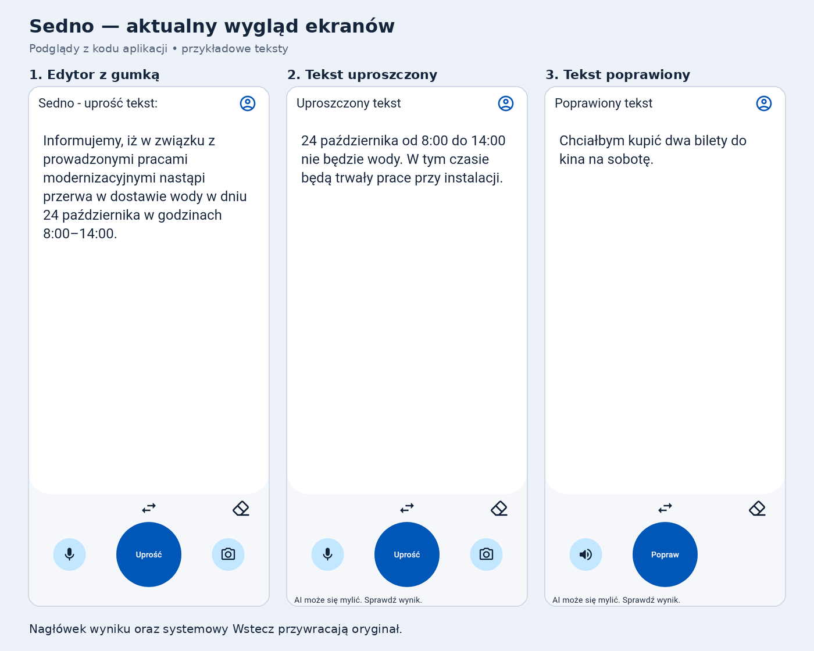

# Podglądy aktualnego edytora

Wygenerowane z rzeczywistych widgetów Flutter, w rozmiarze logicznym 412 × 892.
Teksty są przykładowe; generowanie podglądów nie wywołuje AI.
Nie są to zdjęcia telefonu — nie zawierają systemowych pasków Androida.

- [Edytor z gumką](01-edytor-z-gumka.png)
- [Tekst uproszczony](02-tekst-uproszczony.png)
- [Tekst poprawiony](03-tekst-poprawiony.png)

Nagłówek wyniku i systemowy Wstecz przywracają oryginał ostatniej operacji.
Gumka jest po prawej stronie przełącznika trybu i usuwa tekst oraz zapamiętany oryginał.
